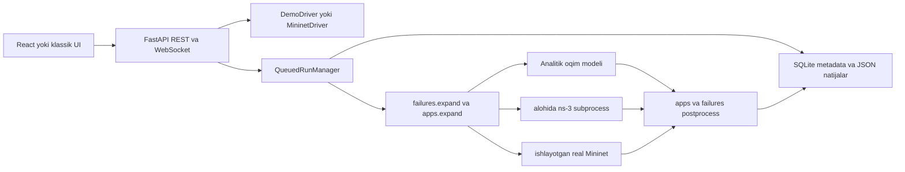

# NetLab arxitekturasi

NetLab’da bitta loyiha modeli, ikkita jonli driver va uchta hisoblash dvigateli bor.
Root `light_simulation.py` esa CSV dataset yig‘ish uchun alohida eski workflow;
uning routing label’i nazariy, forwarding’i L2 learning ekanini aralashtirmang.



## Loyiha va ssenariy

`lab/model.py` qurilma, link, interfeys, controller, P4 va ssenariy validatsiyasini
muvofiqlashtiradi. Protokol/xizmat tekshiruvlari alohida modullarga ajratilgan:
`bgp`, `isis`, `services`, `firewall`, `stp`, `mcast`, `vrrp`, `lag`, `failures`.
`topogen` ring/star/tree/campus loyihalarni deterministik yaratadi.

Ssenariy duration/apps/events bilan aniqlanadi. MTBF/MTTR avval aniq hodisalarga
yoyiladi, so‘ng VoIP/HTTP/FTP transport oqimlariga aylanadi. Engine natijasidan
MOS, fayl/sahifa vaqti va availability hisoblanadi. Asl ssenariy natijada saqlanadi.
`traffic.import_matrix` CSV/gravity matritsasini shu modelga mos ssenariyga aylantiradi.

## Dvigatellar va aniqlik

| Qism | Mexanizm | Asosiy cheklov |
|---|---|---|
| Demo driver | L2/L3 forwarding va terminal modeli | Haqiqiy kernel yoki FRR emas |
| Analytic | UDP sig‘im taqsimoti, TCP max-min/Mathis, queue modeli | Paket darajasidagi TCP dinamikasi yo‘q |
| ns-3 | Paket simulyatsiyasi, alohida jarayon | Ko‘p protokol yo‘llari modeldan statik o‘rnatiladi |
| Mininet | Haqiqiy namespaces/OVS/FRR/iperf/ping | Root, kernel imkoniyati va host resurslariga bog‘liq |

ns-3’da RIP uchun RIPv2 bor; OSPF/IS-IS model yo‘llari statik routingga aylanadi.
`ospf.py` IPv4 startup network/area/passive tanlashini va per-area hop SPF’ni
hisoblaydi; policy keshi bitta `Net` snapshotida qoladi. [OSPF siyosati](ospf-policy.md).
IPv6 — bir ssenariy uchun alohida family: `ip6`/`gateway6` tanlanadi. Address-family
farqlari `addressing.py` va `engines/ns3_addressing.py`da ushlanadi. DHCPv6/NAT66/
IPv6 BGP/multicast bu bosqichga kirmaydi. `ns3_fast` taxminiy rejimining tradeoff’lari
README’da qayd etilgan; natijani aniq rejim bilan teng deb ko‘rsatmang.

## Net keshlari va mutable holat

`drivers/demo_driver.Net` qisqa umrli snapshotdir. Interfeyslar, port/link indekslari,
STP, LAG, route/SPF va BGP keshlari shu snapshot davomida ishlaydi. Link/pozitsiya
o‘zgargach eski Net obyektini cheksiz qayta ishlatish noto‘g‘ri; engine yangi snapshot
yaratadi. LAG forwarding cache kalitiga flow hash ham kiradi.

Analitik `project` boshlang‘ich koordinatalarni saqlaydi, `proj` esa mutable run
holatidir. Ularni bitta obyektga aylantirish harakat trayektoriyasini buzadi;
bu holat regressiya testi bilan himoyalangan. Family tanlash ham foydalanuvchi
loyihasini joyida o‘zgartirmaydi.

## Run lifecycle va saqlash

API server `QueuedRunManager`dan foydalanadi. Global executor normal run va study
variantlari hamda takroriy experiment runlari uchun umumiy limit beradi. SQLite — identity/status metadata, JSON —
oqim/link/node series. UUID bir soniyada va turli loyihalarda ID to‘qnashuvini
oldini oladi. Qayta startda dead-owner pending run’lar interrupted bo‘ladi;
ular o‘z-o‘zidan takroran ishga tushmaydi. Bitta results katalogida bitta server
ishlating. PID reuse hali recovery cheklovidir.

Cancel queued run’ni darhol yakunlaydi; active analytic run progress callback’da
to‘xtaydi. Silent ns-3 child ham cancel qilinadi va reaped bo‘ladi. Emulyatsiya
cleanup’i callback xatosida ham tracked child processlarni yopadi. Batafsil:
[run-queue.md](run-queue.md). SQLite, foydalanuvchi loyihalari va run natijalari ignored
lokal holat; source commit bilan live process saqlanmaydi.

`experiments.py` 2..25 mustaqil takrorni tayyorlaydi; ns-3 bir seed bilan alohida
run substreamlardan foydalanadi. Har run summary bitta statistik namuna bo‘ladi,
to‘liq/mos to‘plam uchun Student t 95% CI hisoblanadi. `reproducibility.py` asl loyiha,
expand qilingan ssenariy, input hash va runtime manifestni run natijasiga qo‘shadi.
HTML/ZIP eksport shu snapshotlardan olinadi, jonli loyihaning keyingi holatidan emas.
[experiments.md](experiments.md) semantika va qayta bajarish shartlarini tushuntiradi.

`engines/result_index.py` natija JSON’larining `(mtime_ns,size)` signaturasini SQLite
metadata bilan solishtiradi. O‘zgarmagan series ro‘yxat polling’ida o‘qilmaydi;
experiment/study tanlash SQL filtriga tushadi. Pagination count/page bitta read
snapshotdan olinadi. Migratsiya, reindex va kattalik cheklovlari:
[result-index.md](result-index.md).

`analysis_windows.py` tayyor analytic/ns-3 series’lardan to‘liq tanlangan binlarni
duration bilan og‘irlab hisoblaydi. Yangi flow nuqtalarida aniq interval chegaralari
saqlanadi; experiment CI har running window mean’i ustida hisoblanadi. Default
summary semantikasi saqlangan. [analysis-windows.md](analysis-windows.md).

`experiment_comparison.py` seed/substream juftlaridan candidate−baseline delta va
paired Student t CI hisoblaydi; runtime/clock/flow identity mosligi tekshiriladi.
`experiment_comparison_report.py` audit CSV/raw-input ZIP va standalone HTML’ni
alohida formatlaydi. [experiment-comparison.md](experiment-comparison.md).

`campaigns.py` bir xil seed bilan baseline va parametr variantlarini oldindan
validatsiyalab rejalaydi. `engines/run_submission.py` normal/study/replication/
campaign joblarini umumiy transaction va scheduling gate orqali admit qiladi.
`engines/campaign_store.py` plan va kichik metadatani shu SQLite’da saqlaydi;
status qimmat series’ni o‘qimaydi, report esa exact planned run ID’laridan olinadi.
Queued payloadlar alohida registry’da: cancel bo‘lgach katta loyiha executor
work-item’da ushlanmaydi. [campaigns.md](campaigns.md).

Campaign analysis bitta request ichida `_ComparisonInput` orqali cohort summary,
runtime/flow guard va normalized design’ni qayta ishlatadi. Context manager/global
keshda qolmaydi; keyingi request faylni yangidan o‘qiydi. Compact JSON takroriy
summary o‘rniga shu dokumentdagi cohort reference’ni beradi; default full format
saqlangan. [campaign-analysis-performance.md](campaign-analysis-performance.md).

## Real testlar va qulf

Mininet cleanup global; alohida real testlar yoki serverlarni bir vaqtda ko‘tarmang.
`/tmp/netlab-real.lock` bitta dedicated hostdagi real workflow’larni ajratadi.

```bash
sudo flock /tmp/netlab-real.lock lab/.venv/bin/python -m lab.netlab --driver real
sudo timeout 600 lab/.venv/bin/python -m lab.tests.real_integration l2 ospf fw
```

Barcha `lab.tests.real_*` CLI’lari va ikkala real benchmark qulfni `lab.real_lock`
orqali ichida oladi. Oddiy tashqi `flock` bilan o‘rash ham ishlaydi: kernel tasdiqlagan
merosiy exclusive descriptor qayta ishlatiladi, tashqi qulf muddatidan oldin
ochilmaydi. Band qulfda test exit 1 bilan tarmoqqa tegmasdan to‘xtaydi.
[Real testlarni ishga tushirish](real-testing.md). Qulfga amal qilmaydigan boshqa
server/testlar undan himoyalanmaydi. Real dalillar [saqlangan hisobotda](validation/real-env-2026-11-06.md).

## Auth va UI sinxronligi

CLI localhost uchun ham token yaratadi. HTTP mutations va ikkala WebSocket
Origin’ni tekshiradi; token cookie HttpOnly/SameSite=Strict. Non-browser API client
token talabini saqlaydi. `create_app()`ni qo‘lda embed qilsangiz tokenni o‘zingiz
uzating. Vite development’da avval backend token URL’ini ochib cookie oling.

Jonli o‘zgarish rad etilsa frontend authoritative devices/linksni qayta oladi,
aloqa uzilgan bo‘lsa oldingi holatga qaytadi. Lokal scenario/code tahriri saqlanadi.
UI yangi backend feature’larining barchasini hali tahrirlamaydi; API/JSON mavjud.

## API xaritasi

| Method | Endpoint | Vazifa |
|---|---|---|
| GET | `/api/info`, `/api/templates`, `/api/engines` | Imkoniyat va shablonlar |
| GET | `/api/projects`, `/api/projects/{name}`, `/api/new` | Loyihalarni olish |
| PUT / DELETE | `/api/projects/{name}` | Saqlash/o‘chirish |
| POST | `/api/validate`, `/api/scenario/validate` | Validatsiya |
| GET | `/api/net/status`, `/api/net/project` | Jonli tarmoq holati |
| POST | `/api/net/start`, `/api/net/stop`, `/api/net/capture` | Tarmoq/capture boshqaruvi |
| POST / DELETE | `/api/net/device/{name}`, `/api/net/link/{lid}` | Jonli element qo‘shish/o‘chirish |
| PUT | `/api/net/device/{name}/config` | Qurilma konfiguratsiyasi |
| PATCH | `/api/net/link/{lid}` | Link up/down va parametrlar |
| GET | `/api/net/inspect/{name}` | Qurilma jadvallari/statistikasi |
| POST | `/api/p4/compile`, `/api/net/p4/{name}/load`, `/api/net/p4/{name}/runtime` | P4 compile/load/runtime |
| POST / GET | `/api/net/sdn/{cname}/restart`, `/api/net/sdn/{cname}/log` | SDN boshqaruvi |
| GET | `/api/net/frr/{name}/running-config` | FRR konfiguratsiyasi |
| POST | `/api/topogen`, `/api/traffic/import` | Topologiya va trafik yaratish |
| POST | `/api/runs`, `/api/studies` | Run/study boshlash |
| POST | `/api/runs/{project}/{run_id}/cancel` | Bitta run’ni bekor qilish |
| GET | `/api/runs/{project}`, `/api/runs/{project}/{run_id}` | Run ro‘yxati/natija |
| PATCH / DELETE | `/api/runs/{project}/{run_id}` | Label/o‘chirish |
| POST | `/api/analysis/survivability`, `/api/analysis/survivability/report` | N-1/N-2 tahlili/hisoboti |
| POST | `/api/reports/compare` | Natijalarni solishtirish |
| GET | `/api/runs/{project}/{run_id}/report.html`, `/api/runs/{project}/{run_id}/export.zip` | Run eksporti |
| GET | `/api/studies/{project}/{study_id}/report.html` | Study hisoboti |
| WS | `/ws/events`, `/ws/term/{name}` | Hodisalar va terminal |

Aniq request/response kontrakti uchun joriy serverning `/api/docs` OpenAPI’sini
tekshiring. Bu jadval `lab/server.py`dagi route’lardan ko‘rib chiqilgan.

## Review va keyingi dalillar

[work-sequence.md](work-sequence.md) branchlar tartibi va qolgan tashqi blockerlarni
saqlaydi. Avvalgi branch main’ga merge bo‘lgach keyingisini yangi main bilan
taqqoslang yoki rebase qiling; agent main’ga merge qilmagan.
Nightly/manual real CI workflow’i GitHub’da bajarilmaguncha uning yashilligi
tasdiqlanmaydi. OPNET bilan to‘liq tenglik da’vosi yo‘q: haqiqiy katta FRR/P4
o‘lchovlari, kalibratsiya dalillari va UI feature coverage hali ish talab qiladi.
