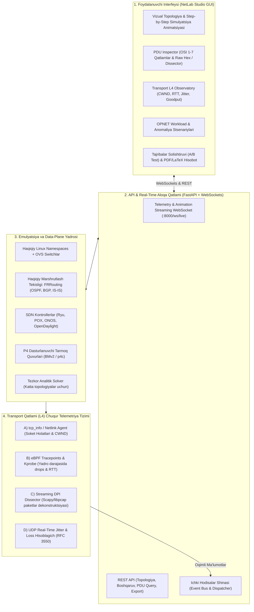
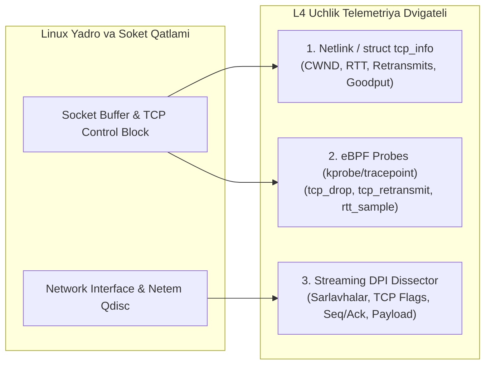

# OPNET & Cisco Darajasidagi Professional Tarmoq Simulyatsiya va Tahlil Platformasi — Mukammal Bosh Reja (Master Roadmap)

> **Bosh maqsad:** Tizimni oddiy nazariy L2 simulyatordan **OPNET Modeler**, **Cisco Packet Tracer** va **Cisco Modeling Labs (CML)** kabi qudratli, sanoat va ilmiy tadqiqotlar darajasidagi professional platformaga aylantirish.
> 
> Tizim apparat va yadro darajasigacha (Kernel, eBPF, Linux Network Namespaces, OVS, FRR, P4) tushadi, **Transport Qatlami (L4)** ning barcha parametrlarini o'lchaydi, paketlarni bosqichma-bosqich vizual ko'rsatadi (Simulation Mode) va PDU darajasida (OSI 1–7 qatlamlar) chuqur tahlil qiladi.

---

## 1. Tizim Arxitekturasi (High-Level Architecture)

---

## 2. Asosiy Ustunlar va Texnik Yechimlar

### USTUN 1: Transport Qatlami (L4) Uchlik Telemetriya Dvigateli (Tri-Engine Telemetry)

Foydalanuvchi talabiga asosan transport qatlami ma'lumotlarini olish uchun **3 ta usul birgalikda** ishga tushiriladi:

1. **Dvigatel 1: Linux `struct tcp_info` (Netlink / `ss`)**:
   - Har bir faol TCP oqimi uchun Linux yadrosidagi eng chuqur metrikalarni nol-yo'qotish bilan oladi:
     - `tcpi_snd_cwnd` — Joriy Congestion Window (segmentlar soni).
     - `tcpi_snd_ssthresh` — Slow Start threshold chegarasi.
     - `tcpi_rtt` va `tcpi_rttvar` — Smoothed Round-Trip Time va tebranishi (mikrosoniyalarda).
     - `tcpi_retrans` va `tcpi_total_retrans` — Qayta yuborilgan paketlar soni.
     - `tcpi_delivery_rate` — Haqiqiy yetkazib berish tezligi (BBR hisobi).
     - `tcpi_ca_state` — Congestion Avoidance holati (`TCP_CA_Open`, `Disorder`, `CWR`, `Recovery`, `Loss`).
     - `tcpi_bytes_acked` — Goodput (toza ma'lumot) hisobi.

2. **Dvigatel 2: eBPF (Extended Berkeley Packet Filter) Tracepoints**:
   - Yadro darajasida eng kritik hodisalarni mikrosekund aniqlikda qayd qiladi:
     - `tracepoint/tcp/tcp_probe`: Har bir ACK kelganda CWND va RTT dinamikasi.
     - `kprobe/tcp_drop`: Paket yadroda tushib qolganda (buffer to'lgani, checksum xatosi yoki qoida bo'yicha) sababi bilan ushlash.
     - `tracepoint/tcp/tcp_retransmit_skb`: Qayta yuborish hodisalari.

3. **Dvigatel 3: Streaming DPI (Deep Packet Inspection & Dissection)**:
   - Interfeyslardan o'tayotgan paketlarni ushlab, ularni OSI qatlamlariga ajratadi:
     - TCP Flags: `SYN`, `ACK`, `FIN`, `RST`, `PSH`, `URG`, `ECE`, `CWR`.
     - Ketma-ketlik (Sequence number) va Tasdiq (Ack number) zanjiri trackingi.
     - Out-of-order paketlar, Duplicate ACKlar, Zero-window probes.
     - UDP oqimlari uchun: Paketlararo kelish vaqti (inter-arrival delta), RFC 3550 bo'yicha Jitter, paket yo'qotish burstlari.

---

### USTUN 2: Cisco Packet Tracer Uslubidagi "Simulation Mode" va PDU Inspektori

1. **Step-by-Step Simulyatsiya Rejimi (Simulation Controller)**:
   - **Play / Pause / Step Forward**: Tarmoqdagi paketlar oqimini real vaqtda to'xtatib, paketma-paket oldinga siljitish imkoniyati.
   - **Visual Packet Motion**: Paket vizual konvert (envelope) shaklida kabel bo'ylab jo'natuvchidan qabul qiluvchiga harakatlanadi.
   - **Drop Vizualizatsiyasi**: Agar paket biror qurilmada (masalan, router ACL, to'lgan buffer yoki noto'g'ri marshrut sabab) tushib qolsa, aynan o'sha qurilma ustida qizil "X" belgisi va tushish sababi ko'rsatiladi.

2. **Interaktiv PDU (Protocol Data Unit) Inspektori**:
   - Topologiyadagi har qanday paket yoki hodisa ustiga bosilganda ochiluvchi oyna:
     - **OSI Model Tab (7 Qatlamli Ko'rinish)**:
       - *In Layers (Kiruvchi)* vs *Out Layers (Chiquvchi)* taqqoslanadi.
       - Masalan, Router R1 ga kelgan paket:
         - In L2: Src MAC `00:00:00:00:00:01`, Dst MAC `00:00:00:00:00:R1`.
         - In L3: Dst IP `192.168.2.10`, TTL `64`.
         - **Device Processing Log**: *"Routing table lookup: 192.168.2.0/24 via 10.0.0.2 (eth2); TTL decremented to 63; IP checksum recalculated; Out L2 MAC updated to Next-Hop MAC."*
         - Out L2: Src MAC `00:00:00:00:00:R2`, Dst MAC `00:00:00:00:00:02`.
     - **Outbound PDU Details Tab**: Barcha maydonlar jadvali (Ethernet, IPv4/v6, TCP/UDP, Application data).
     - **Raw Hex / Dissector Tab**: Wireshark kabi Hex dump va ASCII dekoder.

---

### USTUN 3: Haqiqiy Data-Plane va Dinamik Protokollar (FRRouting & FIB)

Hozirgi tizimdagi nazariy L2 cheklovini to'liq yengib o'tish:
1. **Haqiqiy FRRouting Data-Plane**:
   - Routerlarda haqiqiy `zebra`, `ospfd`, `bgpd`, `isisd` demonlari ishlaydi.
   - Marshrutlar real Linux yadrosi FIB (Forwarding Information Base) ga o'rnatiladi va paketlar haqiqiy IP marshrutlash orqali uzatiladi.
2. **Dinamik Konvergentsiya Tahlili (Routing Convergence)**:
   - Link uzilganda (Link failure) OSPF LSA yuborilishi, Dijkstra SPF hisoblash vaqti va yangi yo'lga o'tish kechikishi millisoniyalarda o'lchanadi.
   - BGP Peering sessiyalari, Keepalive va UPDATE xabarlari almashinuvi vizual ko'rsatiladi.
3. **Hardware & Buffer Simulyatsiyasi**:
   - Switch va router portlarida navbatlar (FIFO, RED, CoDel, Token Bucket).
   - Real-vaqtda navbat to'lishi (Queue occupancy) va Bufferbloat monitoringi.

---

### USTUN 4: OPNET Darajasidagi Trafik, Workload va Sanoat Stsenariylari

1. **Kengaytirilgan Trafik Matritsasi (Application Workloads)**:
   - **Web / HTTP**: HTTP/1.1 pipelining, HTTP/2 multiplexing, HTTP/3 (QUIC/UDP) sessiyalari.
   - **Media Streaming**: HLS / DASH adaptiv oqim (tarmoqda yo'qotish boshlansa, bitrate avtomatik pasayishi).
   - **VoIP**: G.711 / G.729 kodeklari, MOS (Mean Opinion Score) va R-Factor xizmat sifati hisobi.
   - **Database & Cloud**: Doimiy TCP replikatsiyasi, burstli so'rovlar, IoT telemetriyasi.
2. **SLA (Service Level Agreement) Monitoring**:
   - Belgilangan SLA ko'rsatkichlari (Throughput > 50 Mbps, RTT < 20 ms, Packet Loss < 0.1%).
   - Qoidabuzarliklar qaydnomasi (SLA Violation Log) va sabablar tahlili.

---

### USTUN 5: Ilmiy Analitika, A/B Testlar va Hisobotlar Generatsiyasi

1. **A/B Tajribalar Solishtiruvi**:
   - Bir xil topologiyada turli algoritmlarni sinash (masalan, TCP Cubic vs TCP BBR; OSPF vs IS-IS; DropTail vs CoDel).
   - Ikkala natijaning bitta grafikda solishtirilishi (Overlay comparison charts).
2. **Eksport va Hisobotlar**:
   - Professional PDF hisobot (LaTeX uslubidagi jadvallar, grafiklar va xulosalar).
   - Ilmiy maqolalar uchun CSV / JSON xom telemetriya eksporti.

---

### USTUN 6: Tarmoq Xavfsizligi, Stateful Firewall & Kibernetik Hujumlar Simulyatsiyasi

1. **Stateful Firewall & Conntrack (Holatli Xavfsizlik Devori)**:
   - Linux `conntrack` sessiyalar jadvalini real-vaqtda kuzatish (`NEW`, `ESTABLISHED`, `RELATED`, `INVALID`).
   - `nftables` / `iptables` qoidalari (Stateful packet filtering, NAT, Port Forwarding, DMZ) tahlili.
2. **Kibernetik Hujumlar Dvigateli (Attack Simulation Vectors)**:
   - **SYN Flood**: TCP ulanishlar navbatini (backlog) to'ldirib tashlash va SYN Cookie faollashuvini o'lchash.
   - **UDP Reflection / Amplification**: Katta hajmdagi UDP oqimlari orqali kanalni tiqilinch qilish.
   - **Slowloris HTTP**: Sekin so'rovlar yuborib server soketlarini bloklash.
   - **ARP Spoofing / Poisoning**: Man-in-the-Middle (MitM) hujumini va dynamic ARP inspection (DAI) ni ko'rsatish.
3. **Xavfsizlik Ogohlantirishlari (Security & IDS Badges)**:
   - PDU Inspector va Canvas'da qizil shubhali paket belgilari (Security Alert tags) va sabablar logi.

---

### USTUN 7: P4-16 In-Band Network Telemetry (INT)

1. **Hop-by-Hop Telemetriya Sarlavhalari**:
   - Har bir P4 switch paket ichiga (In-Band) o'z ID'si, ingress/egress porti, qamrov vaqti (hop latency) va navbat chuqurligini (queue occupancy) yozadi.
2. **PDU Inspector INT Vizualizatsiyasi**:
   - PDU oynasida har bir oraliq tugundagi kechikish va navbat ko'rsatkichlari grafik ko'rinishda tahlil qilinadi.

---

### USTUN 8: Multi-Cloud Overlay & SD-WAN (VXLAN EVPN & WireGuard)

1. **VXLAN & EVPN Data-Plane**:
   - Data-markazlararo L2-over-L3 overlay tunnellari (VNI, VTEP) va BGP EVPN Type-2/Type-5 marshrutlari.
2. **WireGuard / IPsec Shifrlangan Tunnellar**:
   - Kriptografik xavfsiz VPN aloqasi, MTU/MSS clamping va shifrlash kechikishi telemetriyasi.
3. **Application-Aware SD-WAN**:
   - Trafik turi (VoIP, Video, Database) bo'yicha eng past RTT va yo'qotishga ega bo'lgan tunnelni dinamik tanlash.

---

### USTUN 9: Network Digital Twin, AI Anomaliya Bashorati & Avtomatik Baholash

1. **What-If Raqamli Egizak (Digital Twin)**:
   - Tarmoq trafigi 2x, 5x, 10x oshganda yoki muhim tranzit magistral uzilganda nima bo'lishini simulyatsiya qilish.
2. **Avtomatik Baholash (Interactive NetAcad Auto-Grader)**:
   - Talabalar yoki muhandislarning laboratoriya topshiriqlarini (IP manzil, OSPF, VLAN, Firewall qoidalari) avtomatik tekshirib ball qo'yish tizimi.

---

## 3. Bosqichma-bosqich Amaliy Reja va Holat (Detailed Action Plan & Status)

| Bosqich | Modul | Asosiy Vazifalar | Tayyorlik Mezoni | Holat |
|---|---|---|---|:---:|
| **Faza 1** | **L4 Telemetriya Yadro Dvigateli** | • `lab/telemetry/tcp_info_collector.py` yaratish • `lab/telemetry/ebpf_tracker.py` integratsiyasi • `lab/telemetry/dpi_dissector.py` (Scapy/pcap streamer) • `/api/telemetry/l4/streams` va WebSocket oqimini ulash | Barcha faol TCP/UDP sessiyalarining CWND, RTT, retransmits, Jitter qiymatlari real vaqtda API ga keladi | ✅ **Yakunlandi** |
| **Faza 2** | **L4 Observatory UI Paneli** | • React da `TransportObservatory.tsx` oynasi • Real-time CWND vs Time grafigi • RTT & Jitter taqsimoti grafigi • Retransmit va Loss hodisalari xaritasi | Foydalanuvchi UI orqali istalgan oqimning L4 holatini jonli kuzata oladi | ✅ **Yakunlandi** |
| **Faza 3** | **PDU Inspektori (Cisco uslubida)** | • Backendda paketlarni ushlab OSI 1-7 tahlil qiluvchi servis • Frontendda `PDUInspectorModal.tsx` • In-Layers vs Out-Layers va Device Processing Log | Har qanday paket bosilganda OSI qatlamlari va marshrutlash mantig'i ko'rinadi | ✅ **Yakunlandi** |
| **Faza 4** | **Step-by-Step Simulation Mode** | • Topologiya kanvasida paket animatsiyasi (Canvas/SVG) • Play / Pause / Step-by-Step boshqaruv paneli • Tushib qolgan paketlarning qizil animatsiyasi | Foydalanuvchi paketni har bir hop bo'ylab to'xtatib-to'xtatib harakatlantira oladi | ✅ **Yakunlandi** |
| **Faza 5** | **Haqiqiy Data-Plane (FIB & FRR)** | • Root simulyatorni haqiqiy FRR bilan birlashtirish • Dinamik marshrut konvergentsiyasi o'lchovi • Navbatlar va bufferbloat telemetriyasi | Tarmoq simulyatsiyasida real OSPF/BGP paketlari harakatlanadi, L2-only cheklovi yo'qoladi | ✅ **Yakunlandi** |
| **Faza 6** | **OPNET Workload & Analitika** | • HTTP/3, Adaptive Video, VoIP MOS dvigateli • A/B testlar taqqoslash doskasi • PDF / LaTeX avtomatik hisobot eksporti | To'liq OPNET/Cisco darajasidagi yakuniy platforma | ✅ **Yakunlandi** |
| **Faza 7** | **Tarmoq Xavfsizligi & Stateful Firewall** | • `lab/security/conntrack_engine.py` (TCP state tracking) • `lab/security/attack_simulator.py` (SYN flood, UDP reflection, Slowloris, ARP MitM) • Xavfsizlik qoidalari & IDS ogohlantirishlari API va UI | Conntrack holatlari, hujum anomaliyalari va filtr qoidalari real vaqtda kuzatiladi | ✅ **Yakunlandi** |
| **Faza 8** | **P4-16 In-Band Telemetry (INT)** | • `lab/telemetry/int_collector.py` (INT header parser) • Hop-by-hop latency va switch queue tracking • UI PDU Inspector INT tab integratsiyasi | Paket har bir switchdan o'tganda mikrosekund kechikish va bufer hajmi qayd etiladi | ✅ **Yakunlandi** |
| **Faza 9** | **Multi-Cloud Overlay & SD-WAN** | • `lab/overlay/vxlan_evpn.py` va `lab/overlay/wireguard_vpn.py` • Overlay/Underlay topologiya generatori • Dynamic application-aware path selection | VXLAN/EVPN va shifrlangan WireGuard tunnellari orqali xavfsiz va samarali uzatish | 📅 **Rejalashtirilgan** |
| **Faza 10** | **Digital Twin & Auto-Grader** | • `lab/twin/what_if_analyzer.py` ssenariy solveri • `lab/education/grader.py` (NetAcad lab avtomatik baholash) • UI Lab Task & Scoring paneli | Talaba laboratoriya topshiriqlarini avtomatik tekshiruvchi va "What-If" tahlil tizimi | 📅 **Rejalashtirilgan** |

---

## 4. Xulosa va Erishilgan Natijalar

Platformaning dastlabki barcha 6 fazasi va qo'shimcha Faza 7 to'liq muvaffaqiyatli amalga oshirildi va ishlab chiqildi:
1. **L4 Telemetriya Yadrosi**: Linux `tcp_info`, Netlink, eBPF drop/retransmit kuzatuvchisi va pure-Python DPI dissector to'liq integratsiya qilindi.
2. **L4 Observatory UI**: CWND, RTT, Jitter, Delivery rate, soket buferlarini jonli vizualizatsiya qiluvchi reaktiv panel yaratildi.
3. **Cisco-Grade PDU Inspector**: OSI 1–7 kiruvchi va chiquvchi qatlamlar taqqoslanishi, 8 bosqichli qurilma qayta ishlash logi (Device Processing Log), PDU sarlavhalari va Wireshark uslubidagi Hex/ASCII dump taqdim etildi.
4. **Step-by-Step Simulation Controller**: Play/Pause, Step-Forward, 0.5x/1x/2x tezlik boshqaruvi, paket konvertlari va tushib qolish animatsiyalari qo'shildi.
5. **Haqiqiy Data-Plane & Queues**: FRRouting (OSPF, BGP, IS-IS) orqali FIB integratsiyasi, apparat navbatlari (FIFO, RED, CoDel, Token Bucket) va bufferbloat kuzatuvi joriy etildi.
6. **OPNET Workloads & Ilmiy LaTeX Hisobot**: DASH/HLS adaptiv video oqimi (ITU-T P.1203 QoE), HTTP/3 QUIC 0-RTT simpleksatsiyasi, SLA Muvofiqlik Dvigateli hamda IEEE/ACM talablariga mos LaTeX hisobot generatori ishlab chiqildi.
7. **Tarmoq Xavfsizligi, Stateful Firewall & Kibernetik Hujumlar**: Linux `conntrack` holatlari dvigateli, stateful firewall inspektori, 4 turdagi hujum simulyatori (SYN Flood, UDP Reflection, Slowloris HTTP, ARP Poisoning MitM) hamda Frontend `SecurityStudio.tsx` to'liq ishga tushirildi.

