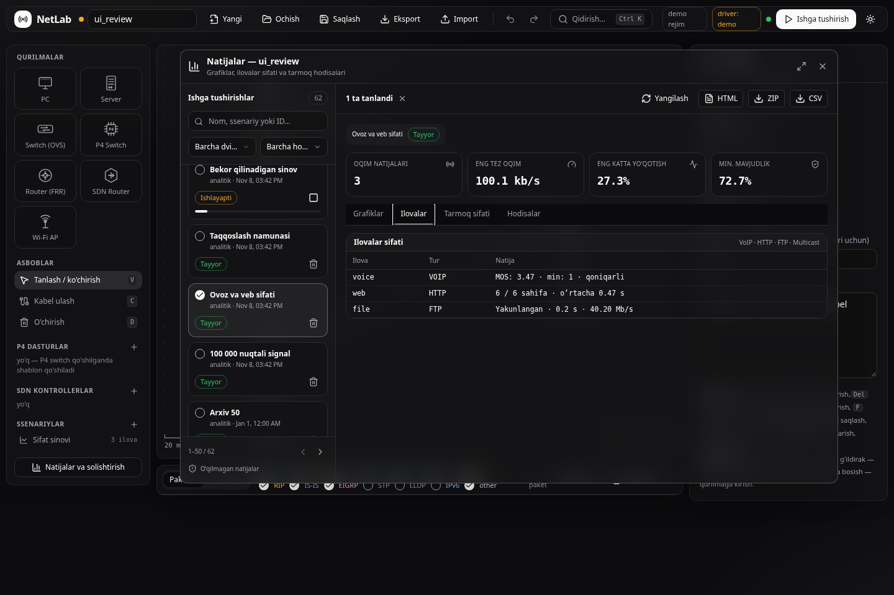
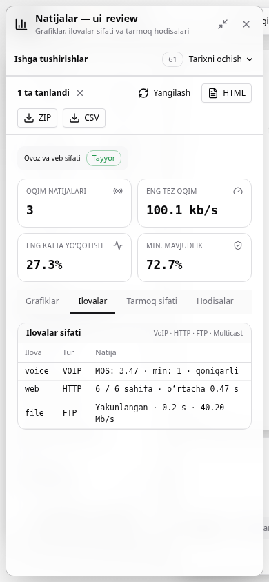

# Natijalar UI tekshiruvi — 2026-11-08

Asos: `main` commit `0450e4e`. O‘zgarishlar `feat/results-workspace` branchida.

## Tekshirilgan holat

`npm ci --no-audit --no-fund`, `npm test` va `npm run build` muvaffaqiyatli.
TypeScript tekshiruvi va ishlab chiqarish yig‘ilishi o‘tdi; `lab/web-react` yangilandi.
Sof yordamchi funksiyalar uchun 7 ta test: yo‘q qiymat/nol, navbat holatlari,
CSV escaping, qidiruv, katta signalning ekstremum/uzilishlari, chekka sonlar va
asl namunalardan tooltip qiymatini olish.

Chrome **157.0.8103.38** va Playwright bilan quyidagi 14 ta tekshiruv o‘tdi:

1. Haqiqiy backend orqali natijalar oynasi va KPI kartalarini ochish.
2. Haqiqiy analitik VoIP MOS, HTTP, FTP natijalari va klaviatura orqali bo‘limlar.
3. Qidiruv, holat filtri, 62 yozuvning server orqali sahifalanishi.
4. CSV/ZIP yuklash va mustaqil HTML hisobotini olish.
5. Ikki natijani solishtirish va ikkala nom saqlangan HTML eksporti.
6. 1D tadqiqotdagi xatoli variantni saqlab ko‘rsatish, grafikda bo‘sh qiymat.
7. To‘rtta haqiqiy analitik variantli 2D xarita; tafsilot so‘rovlarining cho‘qqisi
   uchta parallel so‘rovdan oshmasligi.
8. Buzilgan arxiv diagnostikasi va qayta indekslash.
9. 100 ming nuqtali sintetik signal: bir chiziqda ko‘pi bilan 1200 SVG nuqtasi,
   uzilish alohida segmentda, tooltip 2 soniyalik test chegarasi ichida javob berdi.
10. Vaqtinchalik HTTP 503 xatosini ko‘rsatish va qayta urinish bilan tiklanish.
11. Haqiqiy navbat API orqali ishni bekor qilish va tasdiqlangan o‘chirish.
12. Oq/qora mavzu, oyna kattalashtirish/qaytarish va **390 × 844** ekran:
    ochib-yopiladigan tarix, grafik boshqaruvlari va yopish tugmasi ekran ichida.
13. Oldingi loyiha tafsilot javobi ataylab kechiktirilganda loyiha nomini o‘zgartirish:
    eski natija yangi loyiha oynasiga chiqmaydi.
14. Brauzerning bajarilish xatolari va React ogohlantirishlari yo‘q.

Ma’lumotlar [izolyatsiyalangan test serveri](../../lab/ui/tests/server.py) tomonidan
vaqtinchalik katalogda yaratildi. Ilovalar va 1D/2D variantlar analitik dvigatelda
bajarildi. Katta signal, bitta xatoli variant, buzilgan JSON va kichik arxiv yozuvlari
UI chegaralarini tekshirish uchun maxsus fixture; ular real tarmoq o‘lchovi emas.
Tarmoqda uzoq bajariladigan ish o‘rniga test worker progress chiqarib turadi;
uning bekor qilinishi esa odatdagi queue/token/REST yo‘lidan o‘tadi.

Backend regressiyasi: `lab.tests.smoke_demo` **56**, `lab.tests.smoke_report` **25**
tekshiruv bilan o‘tdi. Demo smoke `NETLAB_SKIP_NS3=1` bilan ishga tushirilgani
sababli undagi ns-3 qismi o‘tkazib yuborilgan. Bu UI iteratsiyasida jonli Mininet,
FRR yoki mahalliy ns-3 qayta sinovi bajarilmadi.

## Ko‘rinish

Quyidagi skrinshotlar test davomida olindi va ko‘zdan kechirildi:

Takrorlash buyruqlari va joriy cheklovlar: [Natijalar oynasi qo‘llanmasi](../ui-results-workspace.md).
