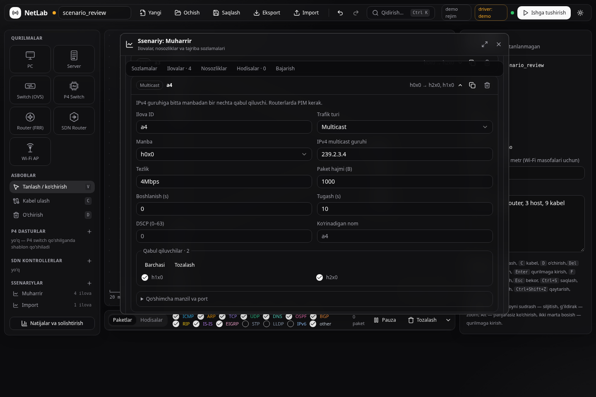
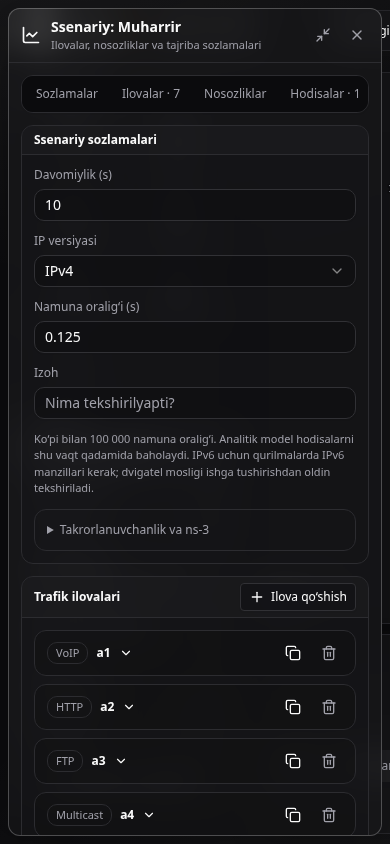

# Ssenariy UI — 2026-11-08

Branch: `feat/scenario-application-editor`. Asos: hali `main`ga qo‘shilmagan
`feat/results-workspace` (`25c77b1`). Yangi o‘zgarishlarni shu branchga nisbatan
ko‘rish mumkin; bu iteratsiya oldingi natijalar UI’sini ham ishlatadi.

## Tekshiruvlar

- TypeScript va Vite ishlab chiqarish yig‘ilishi o‘tdi.
- **14 frontend unit test**: oldingi 7 natija/grafik testi va 7 yangi ssenariy testi.
  Yangi testlar tur almashtirish, multicast konversiyasi, noyob ID, qurilma nomi
  havolalari, study qiymatlari va failure parametrlarini tekshiradi.
- Chrome **157.0.8103.38** orqali **16 ssenariy tekshiruvi**:
  sozlamalarni saqlash; to‘rtta yangi ilova modeli; UDP/TCP/Ping va paket hajmi;
  kabel/qurilma nosozliklari va hodisa; bo‘sh davomiylik; IPv6 multicast’ni to‘sish;
  tez tugagan haqiqiy analitik ish (POST javobi ataylab kechiktirilgan) va holat
  HTTP 503 xatosidan qayta urinish; kodek tadqiqoti; 2D MTBF × kodek tadqiqoti;
  xatoli variant; bekor qilish; import va undo/redo; mobil/mavzu;
  tahrir paytidagi eski preflight javobi; loyiha almashgandagi eski yuborish;
  bajarilish xatolari/React ogohlantirishlari yo‘qligi.
- Oldingi natijalar oynasining **14 brauzer regressiya tekshiruvi** qayta o‘tdi:
  eksportlar, 1D/2D, katta grafik, bekor qilish, filtrlar, mobil ko‘rinish va loyiha
  izolyatsiyasi. Jami **30 brauzer tekshiruvi**.
- `lab.tests.test_simulation_preflight`: **6 test**, OK.
- `lab.tests.smoke_scenario_inputs`: **2 test**, OK; ulardan biri haqiqiy ns-3
  ishlarini **IPv4 va IPv6** bilan bajaradi, ikkinchisi rate birliklarini tekshiradi.

Brauzer fixturesi vaqtinchalik katalogda dual-stack/PIM topologiyasini yaratdi.
UI orqali yetti ilova turi bilan real analitik ish yuborildi; VoIP/HTTP/FTP/multicast
xulosalari, ikkala multicast qabul qiluvchining yetib borishi va availability
tekshirildi. Kodek uchun ikki va MTBF × kodek uchun to‘rtta haqiqiy analitik variant
bajarildi. Ushlab turiladigan ish va bitta variant xatosi maxsus fixture; ularning
holati va bekor qilinishi odatdagi REST/queue yo‘lidan tekshirildi.

Native smoke dastlab `/workspace/venvs/mininet_test` muhitida `cppyy.ns3` import
xatosi bilan yiqildi. Tayyorlangan muhit va kompilyator tanlovi bilan qayta sinov o‘tdi:

```bash
CXX=g++ /workspace/venvs/netlab/bin/python -m lab.tests.smoke_scenario_inputs
```

Bu bajarilish **39.1 s**, ikkala test ham o‘tdi. Ushbu UI iteratsiyasida backend
protokol/dvigatel kodi o‘zgarmadi. Jonli Mininet/FRR qayta sinalmadi; natijalar
UI/analitik va ko‘rsatilgan ns-3 smoke qamrovini bildiradi.

## Ko‘rinish





Qo‘llanma va takrorlash: [Ssenariy muharriri](../ui-scenario-editor.md).
